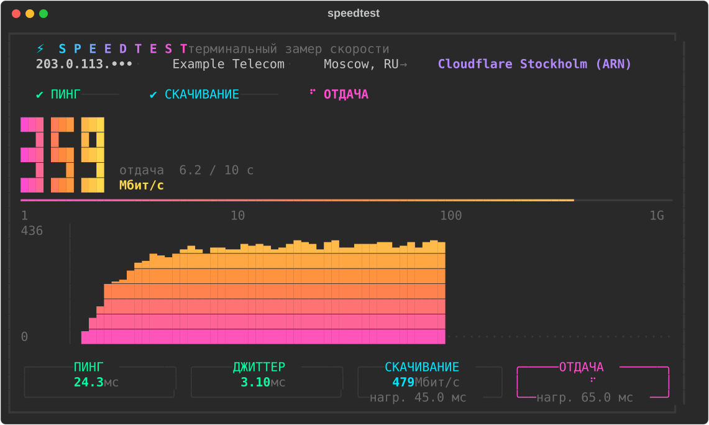
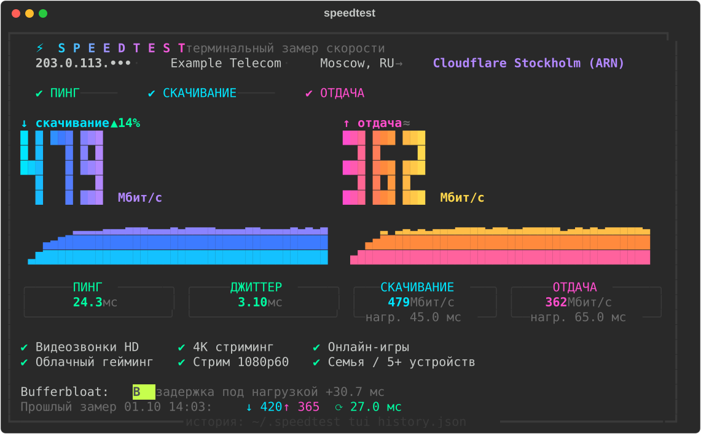

# ⚡ speedtest-tui

Стильный замер скорости интернета прямо в терминале: огромные градиентные цифры,
живой график, шкала скорости и разбор результата — без браузера и рекламы.





## Что измеряет

- **Пинг и джиттер** — 20 HTTP-запросов к ближайшему узлу Cloudflare.
- **Скачивание и отдача** — несколько параллельных потоков, первые секунды разгона TCP не учитываются.
- **Задержку под нагрузкой (bufferbloat)** — пинг во время загрузки канала, с оценкой от A+ до F.
- **Что потянет канал** — видеозвонки, 4K, онлайн-игры, облачный гейминг, стримы, большая семья.
- **Сравнение с прошлым замером** — история хранится в `~/.speedtest_tui_history.json`.

Замер идёт через [speed.cloudflare.com](https://speed.cloudflare.com) — тот же бэкенд,
что у официального теста Cloudflare. IP-адрес на экране частично скрыт, чтобы скриншотами
можно было спокойно делиться.

## Установка

Нужен [uv](https://docs.astral.sh/uv/) (или `pipx`/`pip`) и Python 3.9+.

```bash
uv tool install git+https://github.com/nikmeee/speedtest-tui
```

После этого в любом терминале:

```bash
speedtest
```

Попробовать без установки:

```bash
uvx --from git+https://github.com/nikmeee/speedtest-tui speedtest
```

> Если у вас уже стоит официальный `speedtest` от Ookla, используйте команду `speedtest-tui` — это то же самое.

## Опции

| Флаг | Что делает | По умолчанию |
| --- | --- | --- |
| `-d`, `--duration` | длительность теста скачивания и отдачи, сек | `10` |
| `-s`, `--streams` | число параллельных потоков | `6` |
| `--no-upload` | пропустить замер отдачи | — |
| `--json` | вывести результат в JSON без интерфейса | — |
| `-V`, `--version` | версия | — |

```bash
speedtest -d 15 -s 8
speedtest --json | jq .download_mbps
```

Интерфейс рассчитан на окно шириной от 90 символов; высота графика подстраивается
под размер терминала.

## Разработка

```bash
git clone https://github.com/nikmeee/speedtest-tui
cd speedtest-tui
uv run speedtest
```

## Лицензия

[MIT](LICENSE)
